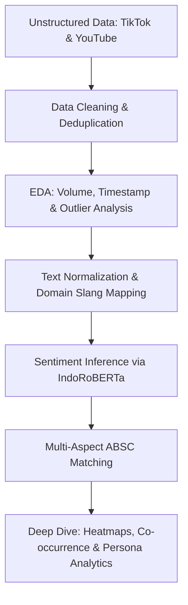

# 📊 Evaluasi Kebijakan Kemensos RI melalui Aspect-Based Sentiment Analysis (ABSA)

## 📌 Project Overview & Strategic Context

Kementerian Sosial (Kemensos) RI memegang tanggung jawab atas jaring pengaman sosial nasional, seperti Data Terpadu Kesejahteraan Sosial (DTKS/DTSEN) dan penyaluran Bantuan Sosial (Bansos). Kebijakan publik yang ditetapkan sering kali memicu opini langsung dan dinamika sosial di media sosial.

Proyek ini dirancang sebagai end-to-end **Data Science & NLP Case Study** untuk menganalisis sentimen publik secara mendalam menggunakan **Aspect-Based Sentiment Analysis (ABSA)** pada data komentar **TikTok** dan **YouTube**. Fokus utama proyek ini adalah mentransformasi *unstructured text data* (komentar media sosial) menjadi *actionable insights* bagi perumusan kebijakan publik.

---

## 🎯 Key Analytical Objectives

1. **Topik Utama:** Mengidentifikasi kebijakan Kemensos mana yang memiliki *public engagement* dan tingkat perhatian paling tinggi.
2. **Distribusi Sentimen & Aspek:** Mengukur sentimen publik dan memetakan keluhan ke dalam sub-aspek kebijakan secara spesifik.
3. **Platform Behavior Analysis:** Membandingkan pola komplain dan pola ekspresi netizen antara pengguna TikTok dan YouTube.
4. **Persona & Co-occurrence Analysis:** Menganalisis kompleksitas isu melalui *aspect density* serta hubungan antar-masalah (*Focused Critics* vs *Angry Generalists*).

---

## 🛠️ Tech Stack & Key Methodologies

* **Programming & Core Analytics:** Python (`pandas`, `numpy`)
* **Natural Language Processing (NLP):** `transformers` (Hugging Face IndoRoBERTa Model), `re` (Regex Cleaners), Custom Indonesian Slang Normalization Engine
* **Exploratory Data Analysis & Visualizations:** `seaborn`, `matplotlib`, `wordcloud`
* **Text Mining & Modeling Techniques:** 
  * *Noise Reduction & Normalization:* Pembersihan mention, hashtag, URL, serta pemetaan kamus slang khusus istilah kebijakan (*bansos, pkh, dtks, kpm*).
  * *Sentiment Classification:* Pipeline pretrained transformer `w11wo/indonesian-roberta-base-sentiment-classifier`.
  * *Aspect Extraction:* Lexicon-assisted Aspect-Based Sentiment Classification (ABSC).

---

## 📂 Taxonomy Aspek Kebijakan (ABSC Framework)

Komentar publik dikategorikan ke dalam 6 sub-aspek utama untuk menangkap nuansa spesifik dari opini masyarakat:

| Sub-Aspek | Fokus Pembahasan / Keyword Clusters |
| :--- | :--- |
| **Akurasi & Sistem** | Desil, DTKS, salah sasaran, verifikasi data, eror aplikasi/link, transparansi |
| **Kinerja & Birokrasi** | Pencairan bank/pos, durasi tunggu, prosedur rumit, kinerja aparat/PNS |
| **Keadilan & Dampak Sosial** | Ketidakadilan, pilih kasih, beban ekonomi, kondisi lansia/janda, kebutuhan pokok |
| **Integritas & Politik** | Indikasi korupsi, pemotongan dana, politisasi bantuan, isu moral/kepercayaan |
| **Regulasi & Hukum** | Regulasi perizinan donasi, sanksi, aturan pidana, pemblokiran/penutupan |
| **Solidaritas & Sinisme** | Gerakan independen (*rakyat bantu rakyat*), kritik satiris, respons komedi |

---

## 🔄 End-to-End Analytics Pipeline

1. **Data Preprocessing & Standardisasi:** Penanganan *missing values*, deduplikasi, serta koreksi tipe data datetime.
2. **Advanced Text Normalization:** Transformasi kata tidak baku (slang) dan ekstraksi istilah domain spesifik kebijakan.
3. **Sentiment Modeling:** Inforensi sentimen tiga kelas (Positif, Netral, Negatif) berbasis konteks menggunakan arsitektur RoBERTa.
4. **Aspect & Co-occurrence Mapping:** Ekstraksi multi-aspek per komentar dan analisis korelasi *pair-wise* antar-isu menggunakan matriks/heatmap.
5. **Persona Segmentation:** Mengklasifikasikan pengkritik menjadi *Focused Critics* (komplain pada 1 aspek) dan *Angry Generalists* (komplain lintas aspek).

---

## 💡 Key Highlights & Value Delivered

* **Data-Driven Public Policy Evaluation:** Mengubah puluhan ribu komentar acak di media sosial menjadi peta masalah kebijakan yang terstruktur.
* **Cross-Platform Analytics:** Mengidentifikasi karakteristik unik di mana pengguna TikTok cenderung memberikan respons singkat dan cepat, sedangkan YouTube memuat narasi keluhan yang lebih panjang dan mendalam.
* **Complex Feature Extraction:** Berhasil mengekstraksi *multi-issue persona* dan mengukur *aspect density score* untuk mengukur tingkat keparahan isu publik.

---

## 👤 Author & Contact

* **GitHub:** [@username](https://github.com/username)
* **LinkedIn:** [Profil LinkedIn Anda](https://linkedin.com/in/username)
* **Email:** email.anda@domain.com